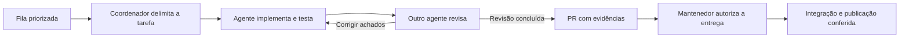

# Evolução contínua do PCM Direto

> Atualização de 21/10/2026: autorizado o fluxo manual limitado de créditos até 30/10.
> Veja [orçamento, limites e operação](CREDITOS-OUTUBRO.md). O executor antigo permanece pausado.


O objetivo é melhorar o sistema em rodadas pequenas, com resultado verificável e sem perder os dados
de quem já usa. Agentes ajudam a entender, implementar e revisar; o mantenedor continua decidindo
as regras de manutenção e o que será publicado.

## Papéis e responsabilidades

| Papel | O que faz | O que entrega |
|---|---|---|
| Coordenador | Confere a fila, escolhe a próxima tarefa pronta e limita o escopo. | Objetivo, responsável, arquivos permitidos e critérios de conclusão. |
| Agente de diagnóstico | Reproduz um problema ou examina uma área delimitada, normalmente sem editar. | Evidência, impacto para quem usa e proposta de correção. |
| Agente implementador | Faz uma única melhoria e os testes necessários. | Mudança pequena, testes e explicação de uso. |
| Agente revisor | Examina de forma independente o código e o comportamento esperado. | Problemas concretos ou resultado da revisão, com suas limitações. |
| Mantenedor | Resolve dúvidas técnicas de manutenção e autoriza a entrega. | Decisões sobre o produto e integração ou publicação. |

São papéis de trabalho, não serviços que precisam ficar ligados. Uma rodada pode usar um coordenador,
um implementador e um revisor, acrescentando diagnóstico especializado quando ele trouxer uma resposta útil.
O coordenador também confere os testes e a entrega.



## Uma implementação por vez

Mantenha uma tarefa em implementação e, quando necessário, uma revisão independente em paralelo.
Diagnósticos podem ocorrer juntos desde que tenham limites claros. Dois agentes não devem editar os
mesmos arquivos ao mesmo tempo no checkout compartilhado.

Uma delegação deve dizer exatamente o que investigar ou mudar, quais arquivos estão sob sua
responsabilidade, qual resultado se espera e como conferir. Não envie uma instrução vaga como
“melhore o sistema inteiro”. Use o checkout existente: tarefas na nuvem já são isoladas, e não há
motivo para criar worktrees sem solicitação explícita.

Cada PR deve tratar de um assunto e, de preferência, partir da `main` atual. Conclua a revisão antes
de iniciar outra implementação. Se a tarefa depender de uma mudança ainda não integrada, mantenha
a dependência registrada na fila, em vez de formar uma cadeia longa de PRs difíceis de revisar.

## Como escolher a próxima tarefa

A fila atual fica em [FILA.md](FILA.md). [MELHORIAS.md](MELHORIAS.md) preserva o diagnóstico e o histórico;
[ROADMAP.md](../ROADMAP.md) mostra a direção do produto.

Siga esta prioridade:

1. Perda de dados, falhas de segurança e tarefas de segurança sem proteção.
2. Erros que impedem cadastrar, revisar, importar, gerar arquivos ou abrir sem internet.
3. Falhas de teclado, celular, acessibilidade e mensagens que não correspondem ao comportamento.
4. Testes e manutenção que previnam regressões demonstráveis.
5. Funções novas com regras e resultado esperado já definidos.

Dentro da mesma prioridade, prefira o maior impacto com menor mudança e evidência mais clara.
Não invente uma pontuação precisa para decisões que ainda dependem da experiência do mantenedor.
Uma tarefa bloqueada não impede avançar na próxima tarefa independente.

## Ciclo de uma rodada

1. **Entender:** ler a tarefa e o estado atual; reproduzir o problema ou definir um exemplo de uso.
2. **Delimitar:** registrar resultado esperado, arquivos afetados, dependências e como testar.
3. **Implementar:** criar um ramo, corrigir uma coisa e acrescentar testes relevantes.
4. **Conferir:** executar as verificações abaixo e investigar qualquer falha.
5. **Revisar:** outro agente examina o resultado e apresenta achados concretos. O autor corrige
   o que for procedente; o revisor confere as correções que afetem seus achados.
6. **Entregar:** abrir PR em português simples e atualizar a fila com o resultado real.
7. **Integrar e publicar:** somente quando houver autorização aplicável. Conferir a publicação
   e registrar a versão entregue, sem confundir PR aberto com função disponível no site.

Prossiga nas tarefas rotineiras já autorizadas. Não peça confirmação a cada comando ou escolha
reversível. Quando faltar uma decisão técnica indispensável, explique o exemplo concreto, a sua
recomendação e o trecho que depende dela; continue o trabalho independente.

## O que precisa passar

Na raiz do repositório:

```bash
npm ci
npm run verificar
```

`verificar` reúne a verificação de código, os testes e a geração da versão final. Para mudanças
de tela, dados salvos, importação, funcionamento offline ou arquivos gerados, acrescente:

```bash
npm run test:navegador
```

A preparação do Chromium e da ferramenta de teste está em [TESTES-NAVEGADOR.md](TESTES-NAVEGADOR.md).
Em ambiente onde o cache padrão do npm não é gravável, use `npm ci --cache /workspace/.npm-cache`.

Os testes devem mostrar que o problema deixou de ocorrer. Mudanças nos dados salvos precisam
preservar listas e backups antigos; mudanças no offline precisam ser conferidas sem conexão;
mudanças em planilha e documento precisam conferir o conteúdo e o aviso permanente.
Não acrescente testes triviais apenas para aumentar a contagem.

## Quando uma tarefa está pronta

- O resultado esperado foi demonstrado com dados fictícios.
- As verificações necessárias passaram; testes não executados, pulados ou bloqueados estão identificados.
- Houve revisão independente e os achados procedentes foram corrigidos.
- As regras do produto, a compatibilidade dos dados e as tarefas de segurança continuam protegidas.
- A fila e os documentos de uso foram atualizados quando necessário.
- O PR explica Antes, Depois, Como testar e Riscos, sem exigir conhecimento de programação para entender a mudança.

É possível abrir um PR ainda aguardando revisão, identificando essa pendência. Ele não deve ser
marcado como concluído ou integrado antes da revisão independente.

Para considerar a entrega publicada, é preciso também confirmar integração autorizada, conclusão
do fluxo do GitHub Pages e presença da mudança no site. Nenhum agente deve marcar um item como
publicado apenas porque os testes passaram.

## Rotina semanal e seus limites

A rotina semanal do GitHub Actions verifica o código, os fluxos no navegador e as dependências,
deixando o resultado para consulta. Ela pode ser iniciada manualmente quando necessário. A rotina não escreve código,
não altera arquivos, não executa agentes de IA e não cria PRs de implementação.

O Dependabot é uma rotina separada: propõe atualizações semanais de dependências e automações,
com limite de dois PRs de atualização de versão por ecossistema; correções de segurança seguem
os limites próprios do GitHub. Não integra nem publica essas propostas automaticamente.
As rotinas passam a valer após a configuração entrar na `main`, respeitando os limites e as
condições do GitHub; execuções agendadas podem atrasar ou ser suspensas pela plataforma.

Quando apontar um problema, a próxima rodada de trabalho deve conferir o relatório e reproduzir
a falha antes de propor uma correção. Um alerta de dependência não autoriza atualizar tudo de uma
vez nem desativar verificações para fazer os testes passarem.

O mantenedor escolheu usar as tarefas do Codex com seu login do ChatGPT Plus para desenvolvimento,
dentro dos limites disponíveis no plano. O GitHub Actions continua executando testes, auditorias e
publicação. O fluxo anterior de implementação por API fica preservado, sem agenda e desativado
explicitamente no código; não reativar sem novo pedido. O passo a passo e os limites estão em
[AGENTES-GITHUB-ACTIONS.md](AGENTES-GITHUB-ACTIONS.md).

Na validação do fluxo anterior, a chave e o modelo foram usados em chamadas reais; revisão e testes
bloquearam uma proposta defeituosa. Isso não comprova uma entrega correta nem execução contínua.
Após uma falha temporária HTTP 401, o acesso ao GitHub voltou e o workflow foi desativado:
`disabled_manually` confirmado. A rodada anterior já estava encerrada. Esta configuração também
retira a agenda e fixa a ativação em false no código. Não reabilitar o workflow sem novo pedido.
Não enviar credenciais pelo chat.

Os PRs #18 e #22 foram integrados. A revisão semanal completa, incluindo navegador e auditorias,
passou em 20/10/2026, assim como a publicação protegida pelos testes.

Não será acrescentada API, assinatura ou serviço pago ao produto. Ferramentas de agentes e contas
de execução têm seus próprios limites; não há promessa de uso ilimitado ou gratuito de IA. O app
continua sem servidor, login, banco de dados ou envio de dados do usuário.

## Como saber se o processo está melhorando

Use a fila, os PRs e os resultados de testes para acompanhar:

| Medida | O que ela ajuda a perceber |
|---|---|
| Tarefas concluídas e tarefas reabertas | Se a melhoria resolveu o problema de forma duradoura. |
| Falhas encontradas antes e depois de publicar | Se a revisão e os testes estão prevenindo regressões. |
| Tempo entre uma tarefa pronta e sua revisão | Se há trabalho acumulado além da capacidade do mantenedor. |
| Falhas repetidas de teste ou publicação | Se uma correção de processo deve ter prioridade. |
| Decisões técnicas pendentes | O que precisa da experiência de manutenção para avançar. |

São medidas do trabalho no repositório, sem analytics, rastreamento ou coleta de uso do aplicativo.
Contagem de testes e quantidade de PRs, sozinhas, não demonstram qualidade.

## Próximas definições do produto

Para iniciar outra rodada de desenvolvimento, use uma tarefa ativa no Codex com esta instrução:

> Continue pela próxima tarefa pronta de docs/FILA.md. Siga AGENTS.md, delegue o diagnóstico quando
> ajudar, faça uma implementação por vez e peça revisão independente a outro agente. Execute as
> verificações necessárias, corrija os achados e entregue um PR pequeno com evidências em português.
> Respeite as autorizações já existentes e registre decisões técnicas pendentes sem bloquear trabalho independente.

Esse pedido inicia uma rodada na sessão disponível; não configura execução permanente.

Os indicadores de falha e as janelas de parada continuam aguardando regras do mantenedor.
Não invente como contar tempo de funcionamento, reparo ou paradas planejadas, nem adie tarefa
de segurança para encaixá-la em uma janela. A biblioteca normativa só pode avançar com fonte
oficial, versão, data e revisão habilitada.

O checklist atual guarda a última marcação de cada tarefa. Histórico completo, fotos e assinatura
exigem desenho e decisão próprios. A conferência manual com leitor de tela, aparelhos reais e
Excel antigo permanece importante, mesmo com o roteiro automático de navegador aprovado.
